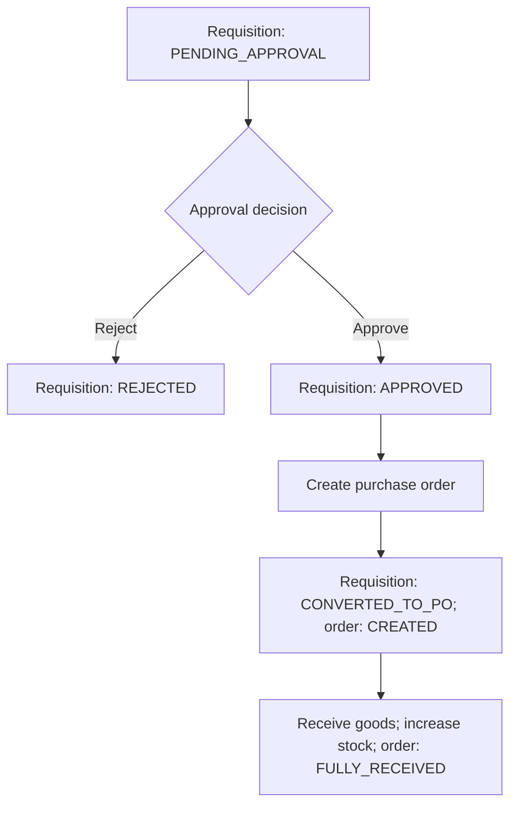

# ProcureFlow — Procurement & Inventory REST API

A Java backend that models procurement from a department's material request to goods receipt and stock updates. Built with **Java 21, Spring Boot 3.5.5, Spring Data JPA, Hibernate, and MySQL**.

The project demonstrates layered backend design, relational entity mapping, approval rules, purchase order calculation, and transactional inventory updates.

**Scope:** an ERP-style backend API. The repository currently contains no frontend, authentication module, invoicing, or payment processing.

[Features](#features) · [Workflow](#procurement-workflow) · [Architecture](#architecture-and-source-guide) · [Setup](#local-setup) · [API](#api-highlights) · [Screenshots](#screenshots-and-demo-evidence)

## Features

- **Material master:** create, list, view, update, and delete materials; store prices, units, stock, and reorder levels.
- **Low-stock lookup:** return materials whose current stock is less than or equal to their reorder level.
- **Vendor master:** manage supplier details, contact information, and active status.
- **Purchase requisitions:** submit material line items and approve or reject pending requests.
- **Purchase orders:** convert an approved requisition into an order for an existing vendor; copy material prices and calculate the total with `BigDecimal`.
- **Goods receipts:** receive all items on an order, add their quantities to material stock, and mark the order as fully received in one transaction.
- **Business checks:** reject duplicate business identifiers on creation, invalid requisition quantities, missing material references, and unsupported approval/conversion states.

Implementation details: [services](src/main/java/com/procureflow/service) and [entities](src/main/java/com/procureflow/entity).

## Tech stack

| Layer | Technology present in the repository |
| --- | --- |
| Language | Java 21 |
| Application framework | Spring Boot 3.5.5 |
| HTTP API | Spring Web, REST controllers, JSON request/response bodies |
| Persistence | Spring Data JPA, Hibernate, Jakarta Persistence mappings |
| Database | MySQL via MySQL Connector/J |
| Build | Maven, Spring Boot Maven Plugin |
| Additional dependencies | Spring Boot Validation and Spring Boot Test starters; JUnit 5 / Mockito service tests are included |

Versions and dependencies are defined in [pom.xml](pom.xml).

## Procurement workflow

1. Create materials and a vendor.
2. Submit a requisition containing at least one material and a positive quantity. The service sets its status to `PENDING_APPROVAL`.
3. Approve or reject the pending requisition.
4. Convert an `APPROVED` requisition into a purchase order. The service calculates the total, sets the order to `CREATED`, and marks the requisition `CONVERTED_TO_PO`.
5. Record a goods receipt. The service receives every order line in full, increases stock, sets the receipt to `RECEIVED`, and sets the order to `FULLY_RECEIVED`.



The enums also define draft, partial-receipt, cancellation, and vendor-sent states, but the current controllers/services do not expose workflows for all of them.

## Architecture and source guide

Requests enter REST controllers, pass through service methods for business rules, and reach MySQL through Spring Data JPA repositories. Controllers currently accept and return entity objects directly.

| Location | Responsibility |
| --- | --- |
| [ProcureFlowApplication.java](src/main/java/com/procureflow/ProcureFlowApplication.java) | Spring Boot entry point |
| [controller/](src/main/java/com/procureflow/controller) | HTTP routes for materials, vendors, requisitions, requisition items, orders, and receipts |
| [service/](src/main/java/com/procureflow/service) | Validation checks, approval transitions, order totals, and stock updates |
| [repository/](src/main/java/com/procureflow/repository) | Six `JpaRepository` interfaces and business-identifier lookups |
| [entity/](src/main/java/com/procureflow/entity) | Eight persistent entities and their relationships |
| [enums/](src/main/java/com/procureflow/enums) | Requisition, order, and receipt status values |
| [application.properties](src/main/resources/application.properties) | Database, Hibernate, and server configuration |

Purchase order creation and goods receipt processing use Spring's `@Transactional`.

### Data model

| Entity / table | Main relationships |
| --- | --- |
| `Material` / `materials` | Referenced by requisition, order, and receipt items |
| `Vendor` / `vendors` | Referenced by purchase orders |
| `PurchaseRequisition` / `purchase_requisitions` | Owns requisition items |
| `PurchaseRequisitionItem` / `purchase_requisition_items` | References a requisition and material |
| `PurchaseOrder` / `purchase_orders` | References a vendor and requisition; owns order items |
| `PurchaseOrderItem` / `purchase_order_items` | References an order and material; stores quantity and unit price |
| `GoodsReceipt` / `goods_receipts` | References an order; owns receipt items |
| `GoodsReceiptItem` / `goods_receipt_items` | References a receipt and material; stores received quantity |

IDs use database identity generation. Material codes, vendor codes, requisition numbers, order numbers, and receipt numbers have unique column constraints.

## Local setup

### Prerequisites

- JDK **21** and Maven installed and available on your path. A Maven wrapper is not included.
- A running MySQL server and an account permitted to create/update tables in the project database.
- Git; optionally curl or Postman for API requests.

**TODO — verified environment:** record the MySQL and Maven versions used for a successful local run.

### 1. Get the source

```bash
git clone https://github.com/53Husain/ProcureFlow-ERP-Procurement-Inventory.git
cd ProcureFlow-ERP-Procurement-Inventory
```

### 2. Create the database

Sign in to your local MySQL instance using your own database account:

```sql
CREATE DATABASE IF NOT EXISTS procureflow_db;
```

The committed configuration uses:

```properties
spring.datasource.url=jdbc:mysql://localhost:3306/procureflow_db
spring.datasource.username=root
spring.datasource.password=YOUR_MYSQL_PASSWORD
spring.jpa.hibernate.ddl-auto=update
server.port=8080
```

Set the username and password for your own local MySQL account in `src/main/resources/application.properties`, or override them through Spring Boot environment variables. For example, in Bash:

```bash
export SPRING_DATASOURCE_USERNAME='YOUR_MYSQL_USER'
export SPRING_DATASOURCE_PASSWORD='YOUR_MYSQL_PASSWORD'
```

Replace both placeholder values. On Windows, set the same variables in your terminal or IDE run configuration. Keep actual passwords out of commits.

Hibernate is configured to create/update tables from entity mappings when the application starts. No SQL migration files, database dump, or seed-data scripts are included.

### 3. Run the application

```bash
mvn spring-boot:run
```

The configured API base URL is `http://localhost:8080/api`. This repository has no homepage UI; use an API client.

Alternatively, build and run the JAR:

```bash
mvn clean package
java -jar target/procureflow-0.0.1-SNAPSHOT.jar
```

### 4. Check the API

```bash
curl http://localhost:8080/api/materials
```

With a newly created, empty database, the list endpoint should return an empty JSON array. This is an expected result from the controller/service code, not a recorded runtime test.

### Accounts and credentials

No application users, login endpoint, authentication configuration, or seeded demo credentials exist in the committed code. `root` is the configured **MySQL username**, and `YOUR_MYSQL_PASSWORD` is a configuration placeholder.

## API highlights

All paths below are relative to `http://localhost:8080`. Routes and parameter names come from the [controllers](src/main/java/com/procureflow/controller).

| Method | Endpoint | Purpose / input |
| --- | --- | --- |
| `POST`, `GET` | `/api/materials` | Create a material using a JSON body; list materials |
| `GET`, `PUT`, `DELETE` | `/api/materials/{id}` | Read, update using a JSON body, or delete a material |
| `GET` | `/api/materials/low-stock` | List materials at or below reorder level |
| `POST`, `GET` | `/api/vendors` | Create a vendor using a JSON body; list vendors |
| `GET`, `PUT`, `DELETE` | `/api/vendors/{id}` | Read, update using a JSON body, or delete a vendor |
| `POST`, `GET` | `/api/requisitions` | Submit a requisition with nested items; list requisitions |
| `GET` | `/api/requisitions/{id}` | Read a requisition |
| `PUT` | `/api/requisitions/{id}/approve` | Approve a pending requisition; no body |
| `PUT` | `/api/requisitions/{id}/reject` | Reject a pending requisition; no body |
| `GET` | `/api/requisition-items/requisition/{requisitionId}` | List a requisition's items |
| `GET`, `DELETE` | `/api/requisition-items/{id}` | Read or delete a requisition item |
| `POST` | `/api/purchase-orders` | Query parameters: `requisitionId`, `vendorId`, `purchaseOrderNumber`; optional `remarks` |
| `GET` | `/api/purchase-orders`, `/api/purchase-orders/{id}` | List orders or read one order |
| `POST` | `/api/goods-receipts` | Query parameters: `purchaseOrderId`, `receiptNumber` |
| `GET` | `/api/goods-receipts`, `/api/goods-receipts/{id}` | List receipts or read one receipt |

Create endpoints declare HTTP `201`; successful delete endpoints declare `204`. Service exceptions have no custom HTTP error mapping in the repository.

### Example requests

These are illustrative requests derived from entity fields and controller signatures. The values are sample business data, and the requests have not been verified against a running instance.

**Create a material:**

```bash
curl -X POST http://localhost:8080/api/materials \
  -H "Content-Type: application/json" \
  -d '{"materialCode":"MAT-DEMO-001","materialName":"Steel Bolt","category":"Hardware","unitOfMeasure":"PCS","unitPrice":12.50,"currentStock":0,"reorderLevel":10,"active":true}'
```

**Create a vendor:**

```bash
curl -X POST http://localhost:8080/api/vendors \
  -H "Content-Type: application/json" \
  -d '{"vendorCode":"VEN-DEMO-001","vendorName":"Demo Supplier","email":"supplier@example.com","active":true}'
```

**Submit a requisition:** send the following JSON to `POST /api/requisitions`. Replace material ID `1` with an existing material's ID.

```json
{
  "requisitionNumber": "REQ-DEMO-001",
  "requestedBy": "Demo Requester",
  "department": "Operations",
  "remarks": "Workshop supplies",
  "items": [
    {
      "material": { "id": 1 },
      "quantity": 20,
      "itemRemarks": "For maintenance"
    }
  ]
}
```

**Continue the workflow:** replace the example IDs with existing records and use unique order/receipt numbers.

```bash
curl -X PUT http://localhost:8080/api/requisitions/1/approve
curl -X POST "http://localhost:8080/api/purchase-orders?requisitionId=1&vendorId=1&purchaseOrderNumber=PO-DEMO-001"
curl -X POST "http://localhost:8080/api/goods-receipts?purchaseOrderId=1&receiptNumber=GR-DEMO-001"
curl http://localhost:8080/api/materials/1
```

## Automated tests

Run with JDK 21 and Maven:

```sh
mvn clean verify
```

The [service tests](src/test/java/com/procureflow/service) cover 25 test cases, including parameterized cases:

- Requisition item validation, duplicate numbers, material resolution, and approval/rejection transitions.
- Purchase-order creation from approved requisitions, decimal totals across multiple items, item relationships, duplicate order numbers, and missing prices.
- Goods-receipt stock updates, receipt relationships, duplicate receipt numbers, empty orders, and missing materials.

Repositories are mocked, so these tests need no running MySQL server or database credentials. [GitHub Actions](.github/workflows/java.yml) compiles, runs tests, and packages the application on Java 21 for pushes and pull requests, then uploads Surefire reports.

**Coverage boundaries:** these are service unit tests, not live database or HTTP integration tests. They do not verify transaction rollback, concurrent requests, JPA mappings, or JSON serialization. The existing ability to receive the same order again using another receipt number remains an unresolved implementation issue described below.

## Current implementation boundaries

- Receipt processing takes every order line in full. Partial receipts and cancellation are not exposed, despite enum values for those states.
- A receipt number must be unique, but the service does not prevent receiving the same purchase order again under a different receipt number. Each call would add the full quantities again.
- Controllers return JPA entities with bidirectional parent/item relationships. No JSON cycle-handling annotations or response DTOs are present; response serialization needs runtime verification.
- Business validation is implemented through selected service checks and database constraints. No controller `@Valid` usage or global exception handler is included.
- JUnit 5 / Mockito unit tests and a Java 21 CI workflow are included. No Swagger/OpenAPI configuration or Postman collection is committed. The tests use mocked repositories; they do not establish database transaction, concurrency, or HTTP serialization correctness.

## Screenshots and demo evidence

**Placeholders — no screenshots or demo recording are included yet.** Since this is an API project, capture actual API-client results and database state.

| Evidence to add | Suggested future file (not present) |
| --- | --- |
| Material creation and low-stock response | `docs/screenshots/materials-api.png` |
| Requisition approval and purchase order result | `docs/screenshots/requisition-to-order.png` |
| Goods receipt and stock before/after | `docs/screenshots/receipt-stock-update.png` |
| Entity relationship diagram exported from the local schema | `docs/screenshots/database-schema.png` |

**TODO — missing documentation:**

- Add verified request/response examples and a Postman collection after exercising the workflow.
- Record the tested Java/Maven/MySQL environment and build/run results.
- Add a short demo recording or hosted demo link if one becomes available.
